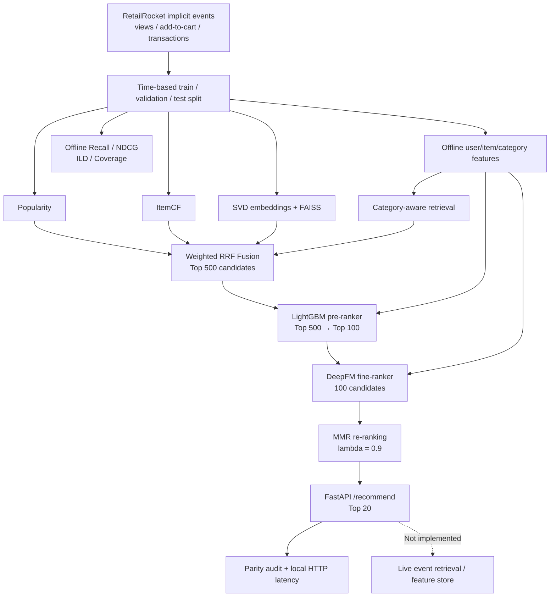

# Multi-Stage Personalized Recommendation System

**Portfolio project | RetailRocket implicit-feedback dataset | Python · DuckDB · FAISS · LightGBM · PyTorch · FastAPI**

> **Scope:** reproducible offline recommendation pipeline with a local HTTP demo. **Not** a production ads platform or an online CTR/CVR estimator. Retrieval candidates and user/item features are precomputed; LightGBM and DeepFM inference run inside the service.

## Highlights

- Time-based evaluation and reproducible feature engineering on implicit event logs.
- Multi-source retrieval: popularity, item collaborative filtering, SVD/FAISS and category-aware candidates, fused with weighted reciprocal rank fusion (RRF).
- Two-stage ranking: **LightGBM Top-500 → Top-100**, then **DeepFM Top-100**, followed by **MMR (λ = 0.9)**.
- Local FastAPI `/recommend` endpoint, model warm-loading, validation-only cascade selection and offline-to-serving parity audit.
- Trade-offs measured across relevance, diversity, coverage, and local sequential HTTP latency.

## Architecture



## Key results (RetailRocket test split)

| Metric | Full-500 + MMR | Selected cascade Top-100 + MMR |
|---|---:|---:|
| Recall@20 | 7.414% | **7.572%** |
| NDCG@20 | 0.055652 | **0.056089** |
| Intra-list diversity@20 | **0.31154** | 0.29637 |
| Average category coverage@20 | **4.781** | 4.320 |

**Serving benchmark:** local Windows / Conda `torch`, single Uvicorn worker, 55 sequential timed requests after five warm-ups. Notebook 16 HTTP **P50 21.23 ms / P95 24.49 ms / P99 26.20 ms**, **46.40 sequential QPS**. No concurrency, network deployment, or cold-start claim. Model inference is real; retrieval/features are cached.

**Validation-only decision:** tried pre-ranking keep={100, 150, 200, 300} against Full-500, with Recall@20 absolute drop ≤ 0.005 and NDCG@20 relative drop ≤ 5%; chose the smallest eligible keep, **100**. Test data was not used to select the keep count. Earlier upstream model and design iterations should not be represented as a fully untouched independent test protocol.

## Reproduce locally (Windows / Conda)

1. Download RetailRocket `events.csv`, `item_properties_part1.csv`, `item_properties_part2.csv`, `category_tree.csv` separately; **do not commit raw datasets or trained models**.
2. Place data in the paths expected by Notebook 01 and use the `torch` Conda kernel.
3. Run notebooks **01–16 in order**, following their own requirements and output paths. The notebooks produce processed Parquet files, model checkpoints, and `data/reports/` reports.
4. For the final local service, place `notebook15_service.py`, `notebook16_service.py`, and `notebook16_requirements.txt` at the repository root. The Notebook 16 service uses components from Notebook 15.
5. Install dependencies with `python -m pip install -r notebook16_requirements.txt` and follow Notebook 16's service startup and parity cells; its report contains the selected candidate count. Run Notebook 17 to regenerate this documentation and the summary tables.

**API:** `GET /health` and `GET /recommend?user_id=<known_user_id>&k=20`. Use a user ID available in the cached test split; this is a closed-world offline demo.

## Experiments

- [`experiment_quality_summary.csv`](experiment_quality_summary.csv) — test Recall@20 and NDCG@20 across retrieval and ranking methods.
- [`validation_cascade_tradeoff.csv`](validation_cascade_tradeoff.csv) — validation-only keep-count sweep.
- [`test_cascade_comparison.csv`](test_cascade_comparison.csv) — final frozen test comparison.
- [`serving_latency_summary.csv`](serving_latency_summary.csv) — Notebook 14/15/16 benchmark summary; note that Notebook 14 is **in-process**, while Notebook 15/16 use **HTTP**, so this is not a controlled apples-to-apples speedup study.
- [`interview_preparation.md`](interview_preparation.md) — system story, trade-offs and likely interview questions.

## Important limitations

1. **Implicit feedback, no impression logs:** unobserved items are not reliable negatives; offline relevance is not CTR/CVR.
2. **Retrieval ceiling:** recall is limited by the Top-500 candidate pool, and pruning trades diversity for computation.
3. **Category metadata:** missing categories can bias ILD and coverage estimates.
4. **No live retrieval or feature store:** cached test users and feature rows are used; cold-start and real-time updates are not implemented.
5. **Small local latency sample:** 55 sequential requests are insufficient for production P99 or concurrent throughput estimates.
6. **No online A/B tests:** all reported improvements are offline and descriptive, not causal business impact.

## Repository layout (suggested)

```text
multi-stage-ads-recommendation/
├── notebooks/                    # Notebooks 01–17
├── notebook15_service.py
├── notebook16_service.py
├── notebook16_requirements.txt
├── data/                         # ignored: raw / processed / reports
├── models/                       # ignored: checkpoints
└── docs/
    ├── architecture.mmd
    ├── experiment_quality_summary.csv
    ├── validation_cascade_tradeoff.csv
    ├── test_cascade_comparison.csv
    ├── serving_latency_summary.csv
    └── interview_preparation.md
```

## Interview-ready summary

> I built a multi-stage recommendation system on RetailRocket event data. I combined multiple retrieval sources using RRF, trained a LightGBM pre-ranker and a DeepFM fine-ranker, and applied MMR to improve category diversity. I used a time-based split, selected the cascade size on validation only, and served the pipeline through FastAPI. Keeping only 100 of 500 candidates preserved test Recall@20 while reducing the DeepFM workload by 80%. The local sequential HTTP benchmark reached around 21 ms P50. The main limitation is that retrieval and features are precomputed, so I do not claim production-scale serving or online CTR lift.
